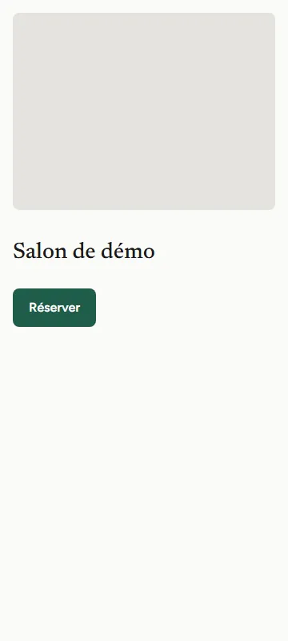
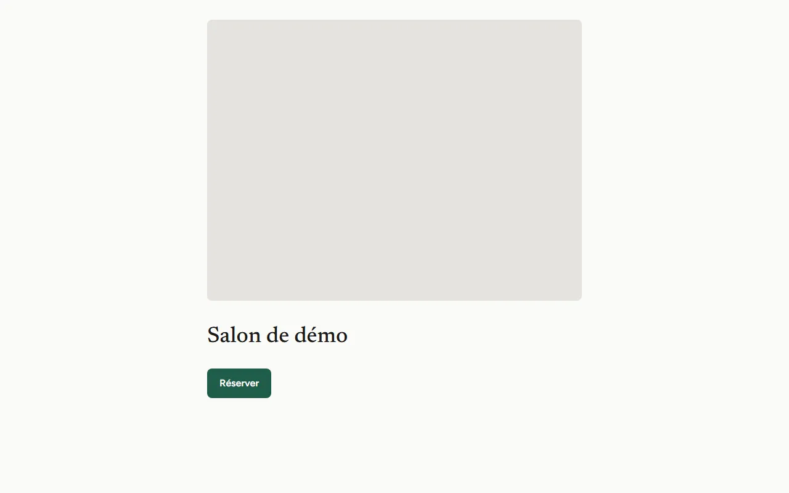
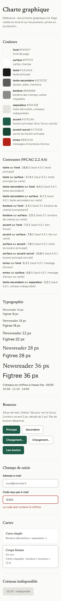
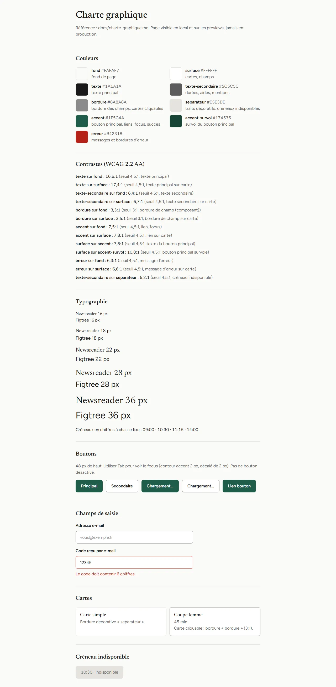
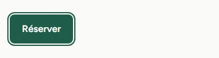

# Charte graphique — site client

Statut : décisions validées par Sparta le 23/10/2026 (issue #20, étape 1).
Aucune couleur ni police hors de ce document. Implémentation : étape 2 de #20.

## 1. Direction

Simple, léger, tranquille. Une ambiance sobre et contrastée, inspirée de
Planity ; le catalogue de prestations en cartes, inspiré de Fresha. Identité
propre : on s'inspire, on ne copie pas.

À éviter : dégradés, glassmorphism, illustrations génériques, textes marketing
creux. Mode clair uniquement en v1 (le mode sombre est l'issue #21).

## 2. Palette

Toutes les couleurs sont des jetons définis à un seul endroit : le thème
Tailwind 4 (`@theme`) dans `web/app/globals.css`. Changer l'accent = changer une
ligne. Aucune couleur écrite en dur ailleurs.

**Un seul accent** : pas de couleur supplémentaire. Les confirmations et succès
utilisent l'accent.

| Jeton | Valeur | Usage | Contraste sur `fond` | sur `surface` | Seuil WCAG 2.2 AA |
| --- | --- | --- | --- | --- | --- |
| `fond` | #FAFAF7 | fond de page | — | — | — |
| `surface` | #FFFFFF | cartes, champs | — | — | — |
| `texte` | #1A1A1A | texte principal | 16,6:1 | 17,4:1 | 4,5:1 |
| `texte-secondaire` | #5C5C5C | durées, aides, mentions | 6,4:1 | 6,7:1 | 4,5:1 |
| `bordure` | #8A8A8A | bordure des champs et du bouton secondaire | 3,3:1 | 3,5:1 | 3:1 (composant) |
| `separateur` | #E5E3DE | traits décoratifs ; fond des créneaux indisponibles | 1,2:1 | 1,3:1 | aucun (décoratif) |
| `accent` | #1F5C4A | bouton principal, liens, focus, succès | 7,5:1 | 7,8:1 | 4,5:1 |
| `accent-survol` | #174536 | survol du bouton principal | — | — | — |
| `erreur` | #B42318 | messages et bordures d'erreur | 6,3:1 | 6,6:1 | 4,5:1 |

Autres couples utilisés :

| Texte | Fond | Contraste | Usage |
| --- | --- | --- | --- |
| blanc #FFFFFF | `accent` | 7,8:1 | bouton principal |
| blanc #FFFFFF | `accent-survol` | 10,8:1 | bouton principal survolé |
| `texte-secondaire` | `separateur` | 5,2:1 | créneau indisponible uniquement |

`separateur` ne délimite jamais un élément interactif : c'est le rôle de
`bordure`, qui respecte 3:1. Le couple `texte-secondaire` sur `separateur` est
réservé aux créneaux indisponibles ; il passe AA (5,2:1), et WCAG dispense de
toute façon les éléments inactifs du seuil de contraste.

## 3. Typographie

- Titres : **Newsreader**. Texte : **Figtree**. Les deux chargées via
  `next/font`, hébergées avec le site (aucun appel à Google à l'affichage).
- Échelle : 16 / 18 / 22 / 28 / 36 px. Rien sous 16 px (BNF-10).
- Interligne : 1,5.
- Chiffres à chasse fixe (`tabular-nums`) sur les créneaux, les durées et les
  prix, pour que les colonnes restent alignées.

## 4. Composants et mise en page

- Conception à 360 px d'abord, puis élargissement (BNF-10).
- Coins arrondis de 8 px ; ombres quasi absentes (une bordure ou le contraste
  `fond` / `surface` suffit).
- Boutons : 48 px de haut. Zones tactiles d'au moins 44 × 44 px.
- **Focus clavier** : contour `accent` de 2 px, décalé de 2 px
  (`outline-offset`), sur tout élément interactif.
- **Bouton principal** : fond `accent`, texte blanc ; survol `accent-survol`.
- **Bouton secondaire** : fond `surface`, bordure `bordure`, texte `texte`.
- **Pas de bouton désactivé dans le parcours.** « Confirmer » reste actif : au
  clic, on affiche ce qui manque (message en `erreur` près du champ concerné).
- **Champ de saisie** : fond `surface`, bordure `bordure` de 1 px, libellé
  toujours visible au-dessus. Placeholder en `texte-secondaire` : c'est du
  texte, seuil 4,5:1 (jamais la transparence par défaut). En erreur : bordure
  de 2 px et message en `erreur`.
- **Carte** : fond `surface`, coins 8 px, bordure `separateur` ou aucune.
- **Carte cliquable** (ex. sélection d'une prestation, #5) : bordure `bordure`
  (3:1), jamais `separateur`, car elle délimite un élément interactif.
- **Bouton en chargement** : reste actif et focusable (pas de `disabled`), mais
  ignore les clics, Entrée et Espace tant que le chargement dure ; libellé de
  chargement et `aria-busy`.

## 5. Parcours de réservation (BNF-9 : 3 écrans hors authentification)

1. **Prestation** : catalogue en cartes.
2. **Créneau** : créneaux libres par jour. Le choix du coiffeur est un filtre
   sur cet écran, « Peu importe » par défaut.
3. **Confirmation** : récapitulatif (prestation, coiffeur, date, heure, prix).

- Aucune connexion pour parcourir les écrans 1 et 2.
- **Connexion à l'écran 3 seulement, par code à 6 chiffres envoyé par e-mail
  (OTP), sans mot de passe ni lien magique** : le client saisit son e-mail,
  reçoit le code et le tape sur le même écran, sans quitter le site.
- Avant d'enregistrer, la disponibilité est revérifiée. Si le créneau vient
  d'être pris : message clair, et retour aux créneaux sans perdre la prestation
  choisie.
- Le gérant et l'app pro gardent la connexion par e-mail et mot de passe.

## 6. Accueil

- Une photo de démonstration, remplaçable par celle du salon : **vraie photo
  d'intérieur de salon**, pas de mannequin posé. Libre de droits (Unsplash),
  choisie à l'étape 2 avec l'accord de Sparta ; sa source sera citée ici.
- Sous la photo, sur fond uni : un titre court et un seul bouton « Réserver ».
- Jamais de texte posé sur la photo.

Source de la photo : *à compléter à l'étape 2*.

## 7. Cartes de prestations

- Contenu : nom, durée, prix.
- Photo facultative : la carte doit être réussie sans photo, qui est le cas
  normal en v1.
- Pas de stockage d'images en v1, sauf la photo d'accueil, fichier statique du
  site.

## 8. Références

- [Planity](https://www.planity.com) : ambiance sobre et contrastée.
- [Fresha](https://www.fresha.com) : catalogue de prestations en cartes.

Sources d'inspiration, pas des modèles à reproduire.

## 9. Mise en œuvre (`web/`)

- Jetons : `web/app/globals.css` (`@theme`). Les valeurs par défaut de Tailwind
  (couleurs, tailles de texte, arrondis, ombres, polices) sont désactivées.
- Composants : `web/components/ui/` (`Bouton`, `BoutonLien`, `Champ`, `Carte`).
- Garde-fou : `npm run lint` lance `web/scripts/verifier-charte.mjs`, qui échoue
  si `app/` ou `components/` contient un code hexadécimal, une classe de palette
  brute (`zinc-500`, `text-white`…), une taille de texte hors charte
  (`text-sm`…), une ombre, un arrondi autre que `rounded-base` ou `dark:`.
- Contrastes : `web/lib/charte.test.ts` vérifie que les jetons de
  `globals.css` sont ceux de ce document et que chaque couple du §2 atteint son
  seuil WCAG 2.2 AA.
- Vitrine : la page `/charte` affiche jetons et composants, en local et sur les
  previews Vercel ; elle répond 404 en production.

## 10. Captures

Emplacement de la photo encore vide : photo d'accueil à choisir (§6).

| | 360 px | 1280 px |
| --- | --- | --- |
| Accueil |  |  |
| Vitrine `/charte` |  |  |

Focus clavier sur le bouton « Réserver » (contour accent 2 px, décalé de 2 px) :

